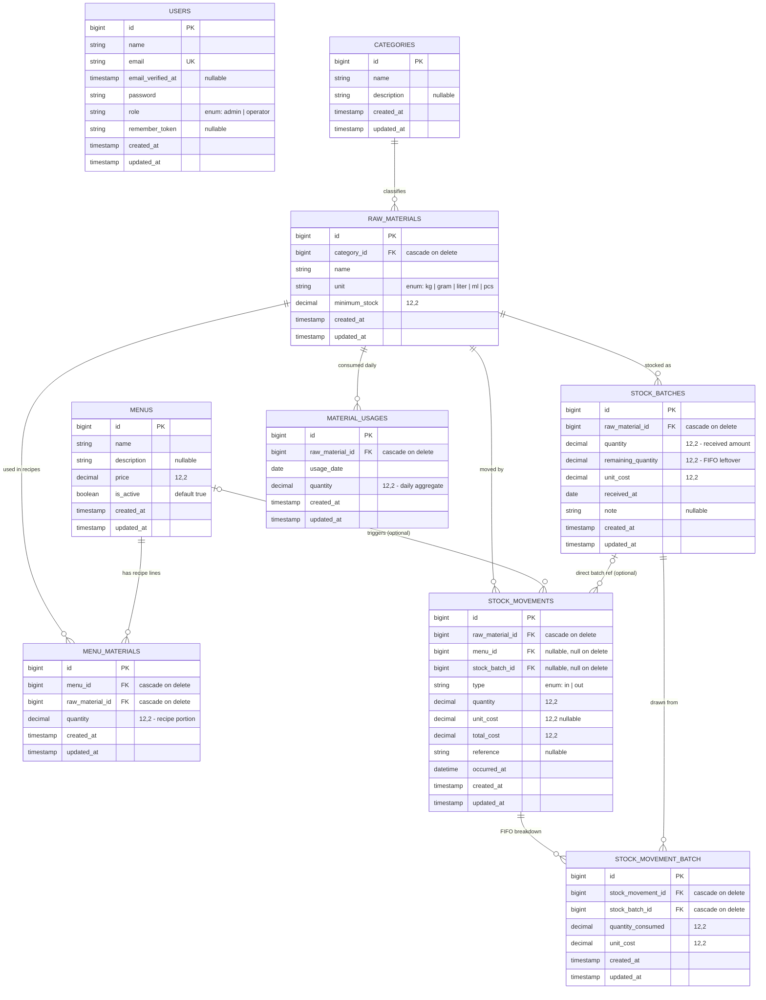

# Entity Relationship Diagram — IMS Restaurant

Derived from `database/migrations/` and `app/Models/`.

## Diagram

## Relationship Notes

| Relationship | Type | Notes |
|---|---|---|
| `categories` → `raw_materials` | 1:N | `Category::rawMaterials()` |
| `menus` ↔ `raw_materials` | M:N via `menu_materials` | Pivot carries `quantity` (recipe portion). Unique on `(menu_id, raw_material_id)` |
| `raw_materials` → `stock_batches` | 1:N | FIFO batches; `remaining_quantity` tracks leftover. `StockBatch::scopeAvailable()` orders by `received_at, id` |
| `raw_materials` → `stock_movements` | 1:N | Every in/out transaction |
| `menus` → `stock_movements` | 1:N (optional) | Set when an OUT movement comes from selling a menu item; `nullOnDelete` |
| `stock_batches` → `stock_movements` | 1:N (optional) | Denormalized direct reference; `nullOnDelete` |
| `stock_movements` ↔ `stock_batches` | M:N via `stock_movement_batch` | The real FIFO breakdown — one OUT movement can drain several batches. Pivot carries `quantity_consumed` and `unit_cost` |
| `raw_materials` → `material_usages` | 1:N | Daily aggregate used for stock prediction. Unique on `(raw_material_id, usage_date)` |

`users` stands alone — it is not referenced by any inventory foreign key. Access is enforced at the route level through `RoleMiddleware` and the `Role` enum, not through ownership columns.

## Excluded Tables

Laravel framework tables, not part of the domain model: `password_reset_tokens`, `sessions`, `cache`, `cache_locks`, `jobs`, `job_batches`, `failed_jobs`.
